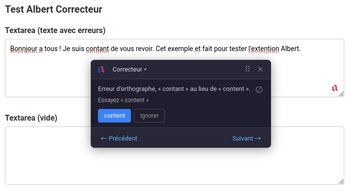
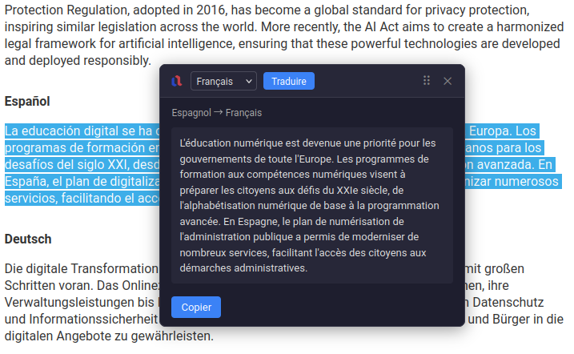

# Albert Correcteur — Extension Firefox

**Extension expérimentale** de correction orthographique, grammaticale et de traduction pour Firefox, propulsée par l'API [Albert](https://albert.sites.beta.gouv.fr/) (DINUM). Elle détecte les erreurs dans les champs texte des pages web, propose des corrections en un clic et permet de traduire n'importe quel texte sélectionné (français, anglais, espagnol, allemand).

**Téléchargement** : [addons.mozilla.org (page développeur)](https://addons.mozilla.org/fr/developers/addon/a8876f404af94bbda3d2/versions)

| Correction et reformulation | Traduction multi-langues |
|:---:|:---:|
|  |  |

## Fonctionnalités

- Vérification automatique 3 secondes après l'arrêt de la saisie
- Vérification du champs de saisie dès le focus
- Vérification manuelle en cliquant sur le badge Albert dans le coin du champ
- Soulignements colorés selon le type d'erreur :
  - **Rouge** — orthographe
  - **Orange** — grammaire
  - **Bleu** — style
- Popup de suggestion avec explication et correction en un clic
- Animation de rotation du logo pendant la vérification
- Fonctionne sur les `<textarea>`, `<input>` et les éléments `contenteditable`
- Compatible avec les éditeurs riches (CKEditor, TinyMCE, Quill, ProseMirror, Draft.js, Lexical)
- Injection dans les iframes (éditeurs intégrés)
- Détection automatique des nouveaux champs ajoutés dynamiquement (SPA, etc.)
- Respect de la limite API (backoff automatique en cas de rate limit)
- **Reformulation** via le menu contextuel (clic droit dans un champ de saisie)
- **Traduction** via le menu contextuel (clic droit sur n'importe quelle sélection de texte)
  - Langues de traduction : français, anglais, espagnol, allemand
  - Détection automatique de la langue source
  - Traduction automatique à l'ouverture dans la dernière langue choisie
  - Bouton "Copier" pour récupérer le résultat

## Conformité RGPD

- **Aucune bibliothèque externe** : pas de CDN, pas de dépendance tierce, tout est embarqué dans l'extension
- **Aucun appel réseau** en dehors du serveur API Albert configuré par l'utilisateur
- **Détection de langue locale** : réalisée côté client sans appel externe
- **Polices système** uniquement (`-apple-system`, `Segoe UI`, etc.)
- Les données saisies ne transitent que vers le serveur API Albert choisi

## Prérequis

- Firefox 109 ou supérieur
- Une clé API Albert (réservée aux agents de la fonction publique d'État) → [Demander un accès](https://albert.sites.beta.gouv.fr/)

## Installation

1. Télécharger le `.xpi` signé depuis [addons.mozilla.org](https://addons.mozilla.org/fr/developers/addon/a8876f404af94bbda3d2/versions)
2. Dans Firefox : `about:addons` → roue dentée → "Installer un module depuis un fichier"
3. Sélectionner le fichier `.xpi`

Pour le développement local avec Firefox Developer Edition, voir [FIREFOX-DEV.md](FIREFOX-DEV.md).

## Configuration

1. Cliquer sur l'icône Albert dans la barre d'outils de Firefox
2. Renseigner :
   - **Clé API Albert** (obligatoire) — au format `sk-...`
   - **Modèle** — menu déroulant chargé dynamiquement depuis l'API (modèles `text-generation`)
   - **URL de l'API** (optionnel) — par défaut `https://albert.api.etalab.gouv.fr`
3. Cliquer sur "Enregistrer"

## Fonctionnement

L'extension utilise l'endpoint `/v1/chat/completions` de l'API Albert (compatible OpenAI) avec un prompt système qui demande au modèle de retourner les erreurs au format JSON structuré (offset, longueur, type, message, suggestions).

Pour les `<textarea>`, `<input>` et les éditeurs riches (CKEditor, TinyMCE, etc.), un overlay transparent est positionné par-dessus le champ pour afficher les soulignements sans modifier le contenu. Pour les éléments `contenteditable` simples, les erreurs sont directement encapsulées dans des ``.

Voir [ARCHITECTURE.md](ARCHITECTURE.md) pour l'arborescence, les flux et les détails techniques.

## Licences

- **Code source** : [licence MIT](LICENSE)
- **Logo Albert** : issu du projet [Albert](https://albert.sites.beta.gouv.fr/) (DINUM), sous [licence Ouverte Etalab 2.0](https://github.com/etalab/licence-ouverte/blob/master/LO.md)

