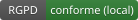

# Albert Correcteur - Extension Firefox, Thunderbird et Brave

**Site de présentation** : [albert-ext-61360e.forge.apps.education.fr](https://albert-ext-61360e.forge.apps.education.fr/)

**Extension expérimentale** de correction orthographique et grammaticale et de traduction pour Firefox, Thunderbird et Brave, propulsée par l'API [Albert](https://albert.sites.beta.gouv.fr/) (DINUM). Elle détecte les erreurs dans les champs texte des pages web (Firefox et Brave) et dans la fenêtre de composition de courriel (Thunderbird), propose des corrections en un clic et permet de traduire n'importe quel texte sélectionné vers une des quatre langues au choix : français, anglais, espagnol, allemand.

**Téléchargement .xpi (signé par Mozilla)** : [RELEASES](https://forge.apps.education.fr/booklageolivier/albert-correcteur/-/releases) | **Sécurité** : [SECURITE](SECURITE.md) | **Accessibilité** : [RGAA](ACCESSIBILITE.md)

| Correction et reformulation | Traduction multi-langues |
|:---:|:---:|
|  |  |

## Fonctionnalités

- Vérification automatique adaptée au quota API (debounce calculé depuis le rpm du compte)
- Vérification immédiate au collage de texte
- Vérification du champ de saisie dès le focus
- Vérification manuelle en cliquant sur le badge Albert dans le coin du champ
- Soulignements colorés selon le type d'erreur :
  - **Rouge** : orthographe
  - **Orange** : grammaire
  - **Bleu** : style
- Popup de suggestion avec explication et correction en un clic (fermeture par Échap ou clic en dehors)
- Animation de rotation du logo pendant la vérification
- Indication visuelle d'une panne API (badge ambre cliquable pour relancer la vérification, message explicite en bulle d'aide)
- Auto-fallback de modèle après deux 429 consécutifs (large -> medium -> small pendant 60 s)
- Résolution des alias serveur via `/v1/models` pour aligner les requêtes sur les identifiants canoniques des modèles
- Affichage de l'usage du jour (rpd, tpd) synchronisé avec `/v1/me/usage` (depuis minuit UTC) et des paliers EXP/PROD documentés dans le popup de configuration
- Fonctionne sur les `<textarea>`, `<input>` et les éléments `contenteditable` (Firefox et Brave)
- Compatible avec les éditeurs riches : CKEditor, TinyMCE, Quill, ProseMirror, Draft.js, Lexical, WhatsApp Web, Slack (Firefox et Brave)
- Gestion des saisies IME (langues CJK) sans déclenchement intempestif
- Désactivation automatique du correcteur natif du navigateur sur les champs suivis (Firefox et Brave)
- Masquage automatique des éléments Albert lors de l'ouverture d'une modale Bootstrap (Firefox et Brave)
- Injection dans les iframes et éditeurs intégrés (Firefox et Brave)
- Détection automatique des nouveaux champs ajoutés dynamiquement, SPA, etc. (Firefox et Brave)
- Respect de la limite API (fenêtre glissante 60 s via la classe partagée `Albert.RollingWindow`, backoff adaptatif calculé depuis le rpm du compte, lecture du Retry-After dans l'en-tête HTTP et dans le corps de la réponse 429)
- Accessibilité (RGAA) : attributs ARIA sur le badge, les popups et annonces pour lecteurs d'écran
- Mises à jour automatiques via `updates.json` (Firefox et Thunderbird vérifient périodiquement les nouvelles versions ; sous Brave, la mise à jour se fait par le Chrome Web Store)
- Reformulation via le menu contextuel (clic droit dans un champ de saisie)
- Traduction via le menu contextuel (clic droit sur n'importe quelle sélection de texte)
  - Langues de traduction : français, anglais, espagnol, allemand
  - Détection automatique de la langue source
  - Traduction automatique à l'ouverture dans la dernière langue choisie
  - Bouton « Copier » pour récupérer le résultat

## Prérequis

- Firefox 128 ou supérieur, Thunderbird 128 ou supérieur, ou Brave (ou un autre navigateur Chromium récent)
- Une clé API Albert (réservée aux agents de la fonction publique d'État) → [Demander un accès](https://albert.sites.beta.gouv.fr/)

## Installation

###  Firefox

1. Télécharger le `.xpi` signé par Mozilla depuis les [Releases GitForge](https://forge.apps.education.fr/booklageolivier/albert-correcteur/-/releases)
2. Dans Firefox : `about:addons` → roue dentée → "Installer un module depuis un fichier"
3. Sélectionner le fichier `.xpi`

Le `.xpi` est signé automatiquement par Mozilla (canal unlisted) lors du pipeline CI/CD, ce qui permet l'installation sur **Firefox standard** sans manipulation.

**Configuration** : cliquer sur l'icône Albert dans la barre d'outils de Firefox.

###  Thunderbird

1. Télécharger le `.xpi` Thunderbird depuis les [Releases GitForge](https://forge.apps.education.fr/booklageolivier/albert-correcteur/-/releases)
2. Dans Thunderbird : Menu > Modules complémentaires > roue dentée > « Installer un module depuis un fichier… »
3. Sélectionner le fichier `.xpi`

**Configuration** : ouvrir une fenêtre de rédaction, puis cliquer sur l'icône Albert Correcteur dans la barre d'outils de composition.

### Brave (et navigateurs Chromium)

L'extension n'est pas encore publiée sur le Chrome Web Store. En attendant, on l'installe à la main :

1. Récupérer le `.zip` Brave depuis les [Releases GitForge](https://forge.apps.education.fr/booklageolivier/albert-correcteur/-/releases), puis le décompresser ; ou bien le construire soi-même avec `./build-brave.sh`, ou `build-brave.bat` sous Windows (le dossier prêt à charger est alors `brave-release/albert-correcteur-brave/`)
2. Ouvrir `brave://extensions`
3. Activer le "Mode développeur" en haut à droite
4. Cliquer sur "Charger l'extension non empaquetée" et sélectionner le dossier décompressé

**Configuration** : cliquer sur l'icône Albert dans la barre d'outils de Brave.

## Fonctionnement

L'extension utilise l'endpoint `/v1/chat/completions` de l'API Albert (compatible OpenAI) avec des prompts système spécialisés (correction, reformulation, traduction) qui demandent au modèle de retourner les résultats au format JSON structuré. Les prompts sont stockés dans des fichiers texte éditables (`sources-commun/prompts/`).

Pour les `<textarea>`, `<input>` et les éditeurs riches (CKEditor, TinyMCE, etc.), un overlay transparent est positionné par-dessus le champ pour afficher les soulignements sans modifier le contenu. L'overlay synchronise 31 propriétés CSS (police, crénage, césure, espacement, etc.) pour un alignement pixel-perfect. Les offsets renvoyés par le LLM sont recalibrés automatiquement en recherchant le mot erroné dans le texte réel. Pour les éléments `contenteditable` simples, les erreurs sont directement encapsulées dans des ``.

Voir [ARCHITECTURE.md](ARCHITECTURE.md) pour l'arborescence, les flux et les détails techniques.

## Conformité RGPD

- Aucune bibliothèque externe : pas de CDN, pas de dépendance tierce, tout est embarqué dans l'extension
- Aucun appel réseau en dehors du serveur API Albert configuré par l'utilisateur
- Détection de langue locale : réalisée côté client sans appel externe
- Polices système uniquement (`-apple-system`, `Segoe UI`, etc.)
- Les données saisies ne transitent que vers le serveur API Albert choisi

## Développement

### Tester l'extension non signée avec Firefox Developer Edition

Le fichier `.xpi` distribué est signé par Mozilla, mais pendant le développement, il est nécessaire de charger une version non signée. Firefox standard refuse les extensions non signées ; il faut utiliser **Firefox Developer Edition** (ou Nightly).

1. **Installer Firefox Developer Edition** depuis le [site officiel de Mozilla](https://www.mozilla.org/fr/firefox/developer/)
2. **Désactiver la vérification des signatures** :
   - Ouvrir `about:config` dans la barre d'adresse
   - Accepter l'avertissement
   - Rechercher `xpinstall.signatures.required` et passer la valeur à `false`

   > Cette option n'est disponible que sur Developer Edition, Nightly et ESR - elle n'existe pas sur Firefox standard.

3. **Charger l'extension** via `about:addons` → roue dentée → « Installer un module depuis un fichier… » et sélectionner le `.xpi` non signé

**Alternative : chargement temporaire** (ne persiste pas après redémarrage) :
- Ouvrir `about:debugging#/runtime/this-firefox`
- Cliquer sur « Charger un module complémentaire temporaire… »
- Sélectionner le fichier `manifest.json` à la racine du répertoire source

### Tester l'extension sous Brave

Brave accepte les extensions Chromium sans signature, en mode développeur :

1. Construire le paquet avec `./build-brave.sh` (ou `build-brave.bat` sous Windows)
2. Ouvrir `brave://extensions` et activer le "Mode développeur"
3. Cliquer sur "Charger l'extension non empaquetée" et sélectionner le dossier `brave-release/albert-correcteur-brave/`
4. Après chaque modification du code, relancer le build puis cliquer sur le bouton de rechargement de l'extension

Pour inspecter le service worker (les logs du fond), cliquer sur le lien "service worker" depuis la fiche de l'extension dans `brave://extensions`.

## Auteur

Olivier Booklage (Académie de Bordeaux)

## Licences

- **Code source** : [licence MIT](LICENSE)
- **Logo Albert** : issu du projet [Albert](https://albert.sites.beta.gouv.fr/) (DINUM), sous [licence Ouverte Etalab 2.0](https://github.com/etalab/licence-ouverte/blob/master/LO.md)
- **Logo Firefox** : sous [Mozilla Public License Version 2](https://www.mozilla.org/en-US/MPL/2.0/)
- **Logo Thunderbird** : sous [licence Creative Commons Attribution 3.0 Non Transposé](https://creativecommons.org/licenses/by/3.0/deed.fr)

> Firefox est une marque déposée de la Mozilla Foundation. Thunderbird est une marque déposée de MZLA Technologies Corporation.
